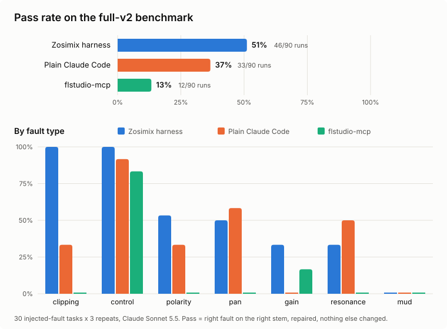
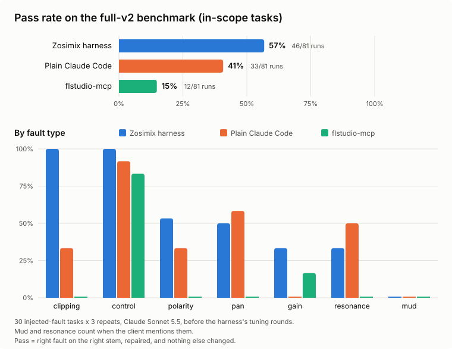

# Zosimix

**Zosimix turns Claude Code into a mix engineer that can't hear: a plugin with measurement tools, a diagnosis playbook and FL Studio integration, plus the evaluation harness and benchmark that prove it works.**

<!-- The demo video goes here (DESIGN.md §6). -->



Claude can't listen to audio. Zosimix gives it a way to "hear" a multitrack mix through measurement tools, lets it repair what it finds (offline or inside FL Studio), and grades every repair against a known answer. The test set is made of faults injected into professionally mixed multitrack recordings, so the correct diagnosis and the correct fix are always known.

**The story behind it:** [Building an eval for an agent that can't hear](docs/blog/building-an-eval-for-an-agent-that-cant-hear.md) covers the benchmark bugs, the fixes that worked and the one that backfired, and the held-out result.

## What Zosimix is

Zosimix has two layers, and neither one replaces Claude Code itself.

- **A Claude Code plugin: the part you install.** Claude Code is the agent harness: it runs the model, the loop, the permissions and the conversation. Zosimix plugs in through Claude Code's own extension points:
  - an MCP server with the measurement tools that act as ears, the mixing controls, and a commit-and-verify step;
  - a skill with the diagnosis playbook;
  - a `/zosimix:fix` command;
  - an optional step that puts the fix into the FL Studio project you have open.

  In other words, it's a domain toolkit that turns a general coding agent into a careful mix engineer.
- **An evaluation harness and benchmark: the part that proves it works.** A task generator plants known faults in real multitracks, a runner launches Claude Code on each task in an isolated workspace, deterministic graders score the answers, integrity checks make sure the agent never sees the answers, and a held-out set of songs is kept away from all tuning.

In the results, **"Zosimix harness"** means Claude Code with the plugin's tools and skill, the configuration under test. **"Plain Claude Code"** is the same agent without them, and **flstudio-mcp** is an existing FL Studio plugin for Claude.

## Results

**On six songs held out from all tuning** (30 tasks, 3 repeats), the harness passes **81%** of tasks against **54%** for plain Claude Code (95% intervals 70–89% and 42–65%). Task by task it does better on 10 and worse on 2 (sign test p ≈ 0.04), using a third of the output tokens: [results/holdout.md](results/holdout.md).

Mud and resonance are matters of taste, so the harness only treats them as faults when the client's note mentions them. Tasks with those faults and no note are reported but not counted in the pass rate, for every configuration (D83). Counting every task, the held-out rates are 62% and 41%.

The table and chart below are the earlier full benchmark (full-v2), with three repeats and all three configurations.



Every configuration runs the same model (Claude Sonnet 5.5) on the same 30 tasks, 3 times each. The difference between them is the tools the model is given.

| | Zosimix harness | Plain Claude Code | [flstudio-mcp](https://github.com/rosasynthesiz/flstudio-mcp) |
|---|---|---|---|
| **Pass rate** (in scope) | **57%** (46/81) | 41% (33/81) | 15% (12/81) |
| Pass rate, every task | 51% (46/90) | 37% (33/90) | 13% (12/90) |
| Partial credit | 0.54 | 0.40 | 0.14 |
| Clipping | 12/12 | 4/12 | 0/12 |
| No fault (leave it alone) | 12/12 | 11/12 | 10/12 |
| Polarity | 8/15 | 5/15 | 0/15 |
| Pan | 6/12 | 7/12 | 0/12 |
| Gain | 4/12 | 0/12 | 2/12 |
| Resonance | 4/12 | 6/12 | 0/12 |
| Mud (with a note) | 0/6 | 0/6 | 0/6 |

A run **passes** only if it names the right fault on the right stem, removes at least 70% of the fault-specific error, and leaves every healthy stem unchanged. Clipping is the exception: baked-in clipping can't be repaired, so the right answer is to report it and change nothing. Partial credit counts a correct but incomplete repair at its repair score.

- Comparing task by task, the harness beats flstudio-mcp on 15 tasks and loses on none (sign test p < 0.001). Against plain Claude Code it wins 10 tasks and loses 4 (p ≈ 0.18): ahead in every repeat, but not yet conclusive on 30 tasks. Details: [results/full-v2.md](results/full-v2.md).
- **Do the graders agree with ears?** In a blind listening check, repairs that the grader passed couldn't be told apart from the original mix in 6 of 6 pairs. That's one listener, a sanity check rather than a study: [results/listening.md](results/listening.md).
- flstudio-mcp is an FL Studio MCP built for producing: its agent can read levels but not spectra, stereo balance or phase, so most faults are invisible to it.
- These full-v2 numbers are the harness **before** its tuning rounds. Those rounds added a `triage` tool, mix-aware mud and resonance rankings, a mistaken-pan check and the spectrogram picture. The revised harness is what the held-out result above measures. How it was tuned, and what didn't work: [results/harness-v2.md](results/harness-v2.md) and [results/week3.md](results/week3.md).

## Use it on your own mix

Zosimix ships as a [Claude Code](https://claude.com/claude-code) plugin: the measurement tools, the diagnosis skill, and a `/zosimix:fix` command. Claude Code is the interface. You describe what sounds wrong, Claude measures, explains what it found, and repairs it with your OK.

**Install** (Claude Code 2.1.275 or later):

```
/plugin install zosimix --marketplace armanokluoglu/Zosimix
```

The tools need Python 3.11+ and the project's packages. Install [uv](https://docs.astral.sh/uv/) and the plugin sets itself up on first use. Without uv, run this once in the plugin's folder (Claude Code keeps it at `%USERPROFILE%\.claude\plugins\cache\zosimix\zosimix\<version>`): `python -m venv .venv`, then `.venv\Scripts\pip install -e ".[fl]"`. Repeat it after a plugin update, which gets a new folder. `claude mcp list` should then show `plugin:zosimix:zosimix ... Connected`.

**Use it:**

1. In FL Studio, export the mixer tracks: **File → Export → WAV** with **Split mixer tracks** ticked. You get one WAV per insert (the master file is ignored).
2. In Claude Code:
   ```
   /zosimix:fix "C:\path\to\the exported stems" the vocals sound boxy
   ```
   Everything after the folder is the client note. Mud and resonance are only treated as faults when the note mentions them; clipping, polarity and mistaken pans are checked either way.
3. Claude reports what it found and changed, track by track, and saves the findings and settings in `zosimix-output` next to the stems.

**Put the fix into the open FL project** (optional, Windows): with the Zosimix MIDI script connected, Claude first shows a dry-run plan, applies it only when you agree, and `revert_fl` undoes it. Changes are relative to what each mixer insert holds now:
- the insert's fader, pan and polarity switch are changed;
- EQ goes into a **Fruity Parametric EQ 2** on that insert whose bands are still flat. FL's scripting API can't add plugins, so if there isn't one, Claude says where to add it.

To connect FL, once:
1. Install [loopMIDI](https://www.tobias-erichsen.de/software/loopmidi.html), create ports named **Zosimix In** and **Zosimix Out**, and leave it running.
2. Copy `fl_bridge/device_Zosimix.py` to `Documents\Image-Line\FL Studio\Settings\Hardware\Zosimix\`.
3. In FL, **Options → MIDI settings**: enable the `Zosimix In` input, set its controller type to **Zosimix Bridge (user)**, and give it a port number. See [fl_bridge/TEMPLATE.md](fl_bridge/TEMPLATE.md) if it doesn't answer.

**What it can and can't do:** it handles the fault types the benchmark covers (level, pan, polarity, resonance, mud, clipping). It measures and repairs; it doesn't make creative mix decisions.

## How it works

**The plugin's core** is an MCP server plus a diagnosis skill for Claude Code ([skills/zosimix-diagnosis](skills/zosimix-diagnosis/SKILL.md)). The agent never hears audio; it measures it:

| Tool | What it tells the agent |
|---|---|
| `triage` | Every objective check at once: clipping, drum polarity, mistaken pans, twin levels, and the top mud and resonance suspects |
| `overview` | Loudness, peak, dynamics, stereo balance and band shape of every stem and the mix |
| `scan` | All stems ranked on one measure (audible resonances, low-mid excess, pan) |
| `spectrogram` | A picture of one stem over the whole song, to confirm a resonance or mud suspect by eye |
| `spectrum`, `compare`, `phase`, `tonal_balance` | A closer look: persistent bumps, masking, drum-mic polarity, shape against other professionally mixed songs |
| `set_gain`, `set_pan`, `set_polarity`, `set_width`, `set_eq_band` | Changes, held as pending until committed |
| `commit_changes` | Applies the changes, re-renders, and reports what measurably moved |
| `submit_diagnosis` | The final answer: refused while changes are uncommitted |
| `open_mix`, `apply_to_fl`, `revert_fl` | Plugin only: load your own exported stems, put the fix into the open FL project (dry run first), undo it |

**The benchmark** injects one fault into one stem of a real multitrack: gain, pan, polarity, resonance, mud or clipping, or nothing at all as a control. Mud and resonance are sized by how much they change the mix, so they can actually be heard in it (D69). Tasks come from a seeded generator, and each task's brief carries at most a vague client note ("the mix feels muddy").

**Two engines** render a mix state: a fast offline engine for the agent's previews and for grading, and FL Studio 20.9.2 driven over a MIDI SysEx bridge. A parity check rendered the same mixes through both: 27 of 28 match to within −40 dB residual, 0.1 dB per band and 0.05 LU. The exception is a known phase difference in FL's low-pass, which no fault needs ([results/parity.md](results/parity.md)).

**Graders are deterministic:** no LLM judge. They check the diagnosis, how much of the fault-specific error the repair removed, and that nothing else changed.

**Eval integrity:**
- Each run gets a fresh workspace outside the repo, holding only the faulty stems and the brief.
- Transcripts are scanned for attempts to reach the answers, and for answers showing up in tool output.
- The harness was tuned only on a separate development set of songs.
- Any commit that touches the graders or the task generator says so.

## Running it

Python 3.11+ with [uv](https://docs.astral.sh/uv/):

```
uv sync --extra dev
uv run pytest
```

Audio is never committed. Fetch AlbumDB songs straight from Zenodo with `python -m zosimix.datasets.albumdb fetch 01 10`. MoisesDB needs its zip from [music.ai](https://music.ai/research/) and `python -m zosimix.datasets.moisesdb import <zip> <track ids>`. The task sets in [tasks/](tasks) are committed.

```
python -m zosimix.runner run --set full-v2 --config zosimix --config plain --repeats 3 --workers 4
python -m zosimix.runner report --run <run id>
python -m zosimix.oracle --set full-v2        # can the measurements single out each fault at all?
python -m zosimix.chart                       # redraws results/chart.svg and chart-full-v2.svg
```

Runs use the Claude Code CLI with a Claude subscription login, never an API key. The FL Studio parts (FL engine, parity check, flstudio-mcp baseline) need FL Studio 20.9.2 on Windows, loopMIDI, and the template described in [fl_bridge/TEMPLATE.md](fl_bridge/TEMPLATE.md).

## Repository

- [DESIGN.md](DESIGN.md): architecture, benchmark design, grading and plan
- [docs/decisions.md](docs/decisions.md): every design decision, with the alternatives and the reasons (75+ entries)
- [results/](results): every evaluation write-up
- [docs/blog](docs/blog/building-an-eval-for-an-agent-that-cant-hear.md): the blog post, *Building an eval for an agent that can't hear*
- `src/zosimix/`: the plugin's tools and MCP server (`tools.py`, `mcp_server.py`, `live.py`), the engines, and the evaluation harness (`faults.py`, `tasks.py`, `graders.py`, `runner.py`)
- `fl_bridge/`: the script that runs inside FL Studio, and the template
- `.claude-plugin/`, `commands/`, `plugin/`: the Claude Code plugin

## Credits

The benchmark uses [MoisesDB](https://github.com/moises-ai/moises-db) (Pereira et al., 2023; CC BY-NC-SA 4.0) and [AlbumDB](https://doi.org/10.5281/zenodo.19683001) (McKenzie et al., 2026; CC BY 4.0). Full citations are in [CITATIONS.md](CITATIONS.md). Code is MIT licensed.

Designed by me, implemented by directing [Claude Code](https://claude.com/claude-code). The process, from design to decision log to review, is part of the project.

The name comes from Zosimos of Panopolis, an early alchemist who wrote about distillation and the equipment used to purify impure material.
